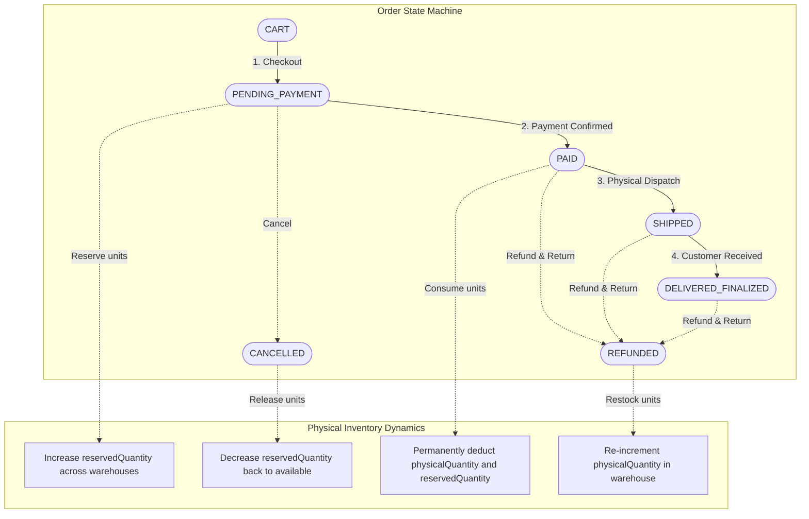

# NexusMarket: Multi-Vendor E-Commerce Platform

NexusMarket is an enterprise-grade, multi-vendor e-commerce platform built with **Java 17**, **Spring Boot 4**, **Domain-Driven Design (DDD)**, and **Hexagonal Architecture (Ports and Adapters)**. The system comprehensively handles multi-warehouse inventory distribution, catalog and product variants, shopping carts, order checkouts with atomic stock reservations, financial settlement, physical logistics dispatch, and automated stock refunds.

---

## 1. Architectural Highlights

- **Strict Hexagonal Architecture:** Separation of concerns into Domain (Core Logic), Application (Granular Use Cases / 30 Services), and Infrastructure (Web REST Adapters and JPA Persistence Adapters).
- **Single Responsibility Principle (SOLID):** One dedicated Application Service per discrete business use case.
- **Distributed Inventory & Stock Locking:** Atomic reservations across multiple warehouses during order checkout, preventing overselling and deadlocks.
- **Role-Based Access Control (RBAC):** Secured with stateless **JWT (JSON Web Tokens)** supporting roles: `BUYER`, `SELLER`, `LOGISTICS_OPERATOR`, `ADMIN`, and `SUPERVISOR`.

---

## 2. Technology Stack

- **Language:** Java 17
- **Framework:** Spring Boot 4.0.6
- **Persistence:** Spring Data JPA / Hibernate ORM
- **Production Database:** MySQL 8.0 (served via Docker)
- **Database Visual Client:** phpMyAdmin (Docker)
- **Test Database:** H2 in-memory (isolated for automated unit/integration tests)
- **Security:** Spring Security & JJWT (io.jsonwebtoken 0.12.5)
- **Build Tool:** Apache Maven (Wrapper included: `mvnw` / `mvnw.cmd`)
- **Containers:** Docker & Docker Compose

---

## 3. Project Directory Structure

```text
Nexus_MarketPlace/
├── docker-compose.yml                     # Multi-container setup (MySQL 8.0 + phpMyAdmin)
├── ENDPOINTS_TESTS.md                     # Step-by-step endpoint testing flows by role
├── NexusMarket.postman_collection.json    # Standard Postman v2.1 collection (30 endpoints)
├── pom.xml                                # Maven dependencies and build plugins
├── src/
│   ├── main/
│   │   ├── java/application/
│   │   │   ├── domain/                    # Pure Enterprise Domain (Zero Framework Dependencies)
│   │   │   │   ├── model/                 # Aggregates, Entities, and Value Objects
│   │   │   │   │   ├── aggregate/         # Order aggregate root
│   │   │   │   │   ├── entity/            # User, Product, InventoryItem, Warehouse, Buyer/Seller Profile
│   │   │   │   │   └── valueobject/       # Money, Sku, Email, OrderStatus, ProductType, StockLocation...
│   │   │   │   ├── ports/                 # Hexagonal Interfaces
│   │   │   │   │   ├── in/                # Inbound Ports (Use Cases & Command Records)
│   │   │   │   │   └── out/               # Outbound Ports (Repository & PasswordEncoder Ports)
│   │   │   │   └── services/              # Domain & 30 Granular Application Services
│   │   │   ├── adapter/                   # Infrastructure Adapters
│   │   │   │   ├── in/web/                # REST Controllers, DTOs & Global Exception Handler
│   │   │   │   └── out/persistence/       # JPA Entities, Spring Data Repositories, Mappers & Adapters
│   │   │   └── config/                    # SecurityConfig, JWT Filter/Provider & DataInitializer
│   │   └── resources/
│   │       └── application.properties     # Main configuration (MySQL on localhost:3306)
│   └── test/
│       ├── java/application/              # Integration and Security Verification Test Suites
│       └── resources/
│           └── application.properties     # Test configuration (In-memory H2, zero setup needed)
```

---

## 4. Business Operational Lifecycle



---

## 5. Prerequisites

Before running the application, ensure you have installed:
- **Java Development Kit (JDK) 17** or higher:
  ```bash
  java -version
  ```
- **Docker Engine & Docker Compose**:
  ```bash
  docker --version
  docker compose version
  ```

---

## 6. Getting Started: How to Run

### Step 1: Start the Database via Docker
From the project root directory, run:
```bash
docker compose up -d
```
This initializes two background containers:
- **MySQL 8.0:** Running on port `3306` with database `nexus_marketplace` (`root` / password: `0000`).
- **phpMyAdmin:** Accessible at **[http://localhost:8081](http://localhost:8081)** (Server: `mysql`, User: `root`, Password: `0000`).

> [!NOTE]
> All MySQL database files are persisted in a Docker volume named `nexus_mysql_data`.

---

### Step 2: Run the Spring Boot Application
Run the Maven wrapper command matching your operating system:

**On Windows (PowerShell / Command Prompt):**
```powershell
.\mvnw.cmd spring-boot:run
```

**On Linux / macOS:**
```bash
./mvnw spring-boot:run
```

The application will start on **`http://localhost:8080`**.

> [!TIP]
> **Automatic Schema Generation:** Hibernate automatically creates and updates all database tables (`users`, `products`, `orders`, `order_items`, `inventory_items`, `warehouses`, `buyer_profiles`, `seller_profiles`) on startup. You do **not** need to run manual SQL creation scripts.

---

## 7. Master Accounts (Auto-Seeded)

For testing privileged administrative and logistics operations, the application automatically seeds two default accounts on startup via [`DataInitializer.java`](file:///c:/Users/Usuario/Desktop/Nueva%20carpeta/Nexus_MarketPlace/src/main/java/application/config/DataInitializer.java):

| Role | Email | Password | Allowed Capabilities |
| :--- | :--- | :--- | :--- |
| **ADMIN** | `admin@nexus.com` | `Admin123!` | User suspension/reactivation, global catalog deactivation, warehouse shutdown, refund approval. |
| **LOGISTICS_OPERATOR** | `logistics@nexus.com` | `Logistics123!` | Physical stock intake, stock damage reports, physical order dispatch (`SHIPPED`), delivery confirmation (`DELIVERED_FINALIZED`). |

---

## 8. Automated Testing

The project includes unit and end-to-end integration test suites (`MarketPlaceApplicationTests` and `SecurityAndValidationGapsTest`).

Run the automated test suite with:
```powershell
.\mvnw.cmd test
```
*(or `./mvnw test` on Linux/macOS)*

> [!NOTE]
> Tests run against an isolated **in-memory H2 database** configured in `src/test/resources/application.properties`. You can execute tests at any time without needing Docker running.

---

## 9. Interactive API Documentation (Swagger / OpenAPI UI)

When the application is running, you can access the visual, interactive Swagger UI in your browser:

- **Swagger UI Web Interface:** **[http://localhost:8080/swagger-ui.html](http://localhost:8080/swagger-ui.html)**
- **Raw OpenAPI JSON Spec:** **[http://localhost:8080/v3/api-docs](http://localhost:8080/v3/api-docs)**

### Testing Authenticated Endpoints in Swagger:
1. Generate a JWT token using the `POST /api/v1/auth/login` endpoint directly in Swagger.
2. Click the green **Authorize** button at the top right of the Swagger UI page.
3. Paste the token into the `Value` box and click **Authorize**.
4. Now all protected endpoints will automatically include the `Bearer <token>` header in your interactive browser calls!

---

## 10. API Testing with Postman

### Quick Import in 5 Seconds:
1. Open your **Postman** desktop application.
2. Click **Import** in the upper-left corner (or press `Ctrl + O`).
3. Select or drag-and-drop the file:
   [`NexusMarket.postman_collection.json`](file:///c:/Users/Usuario/Desktop/Nueva%20carpeta/Nexus_MarketPlace/NexusMarket.postman_collection.json)
4. Click **Import**.

### What the Collection Includes:
- **30 Organized Endpoints:** Categorized into 8 functional folders (*Auth, Users & Profiles, Product Catalog, Warehouses, Inventory, Cart & Orders, Logistics, Refunds*).
- **Automated Variable Extraction:** Every login, registration, cart creation, or product publishing request includes a test script that dynamically captures tokens (`buyerToken`, `sellerToken`, `adminToken`, `logisticsToken`) and IDs (`buyerId`, `sellerId`, `warehouseId`, `orderId`, `sku`) into collection variables.
- **Zero Manual Copy-Pasting:** Execute requests sequentially and variables propagate automatically.

> [!IMPORTANT]
> For the complete, sequential flow instructions and sample payloads, consult the dedicated test guide:
> 📄 **[`ENDPOINTS_TESTS.md`](file:///c:/Users/Usuario/Desktop/Nueva%20carpeta/Nexus_MarketPlace/ENDPOINTS_TESTS.md)**

---

## 10. Summary of Available REST Endpoints

### 1. Authentication (`/api/v1/auth`)
- `POST /register/buyer` - Register a new buyer account.
- `POST /register/seller` - Register a new seller account.
- `POST /login` - Authenticate with email/password and obtain a signed JWT token.

### 2. User & Profile Management (`/api/v1/users`)
- `POST /buyers/secondary-address` - Add a delivery address to a buyer profile.
- `PUT /sellers/tax-id` - Update the tax identifier of a seller profile.
- `PUT /{userId}/suspend` - Suspend a user account.
- `PUT /{userId}/activate` - Reactivate a suspended account.

### 3. Product Catalog (`/api/v1/catalog/products`)
- `POST /` - Publish a new product in the catalog.
- `PUT /` - Update product description and price.
- `POST /variants` - Add a commercial variant (size, color, edition).
- `GET /{sku}` - Get product details by SKU.
- `GET /` - List all active products.
- `DELETE /{sku}` - Logical deactivation of a product.

### 4. Warehouses (`/api/v1/warehouses`)
- `POST /` - Register a physical warehouse.
- `PUT /{warehouseId}/deactivate` - Deactivate a warehouse.

### 5. Physical Inventory (`/api/v1/inventory`)
- `POST /stock` - Ingest physical merchandise into a warehouse.
- `POST /damaged` - Report damaged stock/shrinkage.
- `GET /stock/{sku}` - Query consolidated available stock across all warehouses.

### 6. Cart & Orders (`/api/v1/orders`)
- `POST /cart` - Initialize an empty cart (`CART`).
- `POST /cart/items` - Add item to cart and recalculate totals.
- `DELETE /{orderId}/items/{sku}` - Remove item from cart.
- `POST /checkout` - Perform checkout, lock shipping address, and atomically reserve inventory (`PENDING_PAYMENT`).
- `POST /pay` - Confirm financial payment and permanently deduct reserved stock (`PAID`).
- `POST /cancel` - Cancel unpaid order and release reserved stock (`CANCELLED`).

### 7. Logistics (`/api/v1/logistics`)
- `POST /ship` - Dispatch order physically with tracking number and carrier (`SHIPPED`).
- `POST /deliver` - Confirm physical receipt by customer (`DELIVERED_FINALIZED`).

### 8. Refunds (`/api/v1/refunds`)
- `POST /` - Process order refund and automatically return physical stock to warehouses (`REFUNDED`).

---

## 11. License & Architectural Traceability

This project was built following enterprise Domain-Driven Design (DDD) specifications and strict Hexagonal Architecture standards.
For in-depth layer documentation, refer to the documents in the `SDD/` (Software Design Document) directory.
